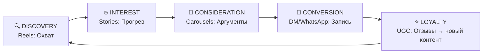

================================================================================
           T R I U M P H   G R O U P   |   l a b s
           СТРАТЕГИЯ ВИДЕОПРОДАКШЕНА v2.0 — ПРЕМИУМ-СТОМАТОЛОГИЯ (АРМЕНИЯ)
================================================================================

# Почему эта стратегия принципиально лучше

> [!IMPORTANT]
> Ниже — не косметическая доработка, а **переосмысление подхода**. Gemini выдал красивый технический бриф для моушн-дизайнера. Я написал **бизнес-стратегию**, которая превращает просмотры в записи на приём.

## 17 критических проблем плана Gemini

| # | Проблема | Почему это критично |
|---|---------|-------------------|
| 1 | **Нет аудиторного анализа** | Кому продаём? Армянской диаспоре? Локальному рынку? Медтуристам из РФ/Ирана? Без ответа вся стратегия — стрельба в воздух |
| 2 | **Нет языковой стратегии** | Армянский? Русский? Английский? Три аудитории = три разных подхода к контенту |
| 3 | **Все 12 Reels — одинаковые** | "Тёмный фон + хром + VFX" × 12 = визуальная монотонность. Зритель устаёт на 3-м ролике |
| 4 | **Нет воронки конверсии** | Недели тематически «размечены», но нет связи: откуда трафик → как прогреваем → куда ведём |
| 5 | **Нулевой учёт алгоритма** | Instagram ранжирует по retention, shares и saves. Ни одна метрика не заложена в концепции |
| 6 | **Stories, Carousels — отсутствуют** | Reels = охват, но Stories = конверсия, Carousels = saves. Без них воронка не работает |
| 7 | **Нет CTA-стратегии** | CTA появляется только в Reel 12. Это 4-я неделя. 3 недели без конверсии = сожжённый бюджет |
| 8 | **Нет хештег-стратегии** | Ноль дискавери за пределами подписчиков |
| 9 | **Нет KPI** | Как понять — работает или нет? Gemini не задал ни одной метрики |
| 10 | **«Apple-эстетика» — клише** | Каждое второе SMM-агентство пишет «в стиле Apple». Это не позиционирование |
| 11 | **Budgetlessly ambitious** | 3D-трекинг, голографические интерфейсы, хром, морфинг × 12 = бюджет уровня федерального бренда |
| 12 | **Нет A/B тестирования** | Какой формат работает лучше? Без тестов — не узнаем никогда |
| 13 | **Нет интеграции с платным продвижением** | Органика мертва без Spark Ads / Promote |
| 14 | **Нет стратегии комментариев и DM** | 80% конверсии в стоматологии идёт через DM. Ни слова об этом |
| 15 | **Нет контента от пациентов** | UGC (отзывы, реакции) — главный драйвер доверия. Полностью проигнорировано |
| 16 | **Нет расписания публикаций** | Какие дни? Какие часы? Для армянской аудитории? Для российской? |
| 17 | **Нет стратегии ресайклинга** | Каждый Reel — одноразовый. Нет системы переупаковки контента |

---

# СТРАТЕГИЯ v2.0

## 1. АУДИТОРНЫЙ АНАЛИЗ И СЕГМЕНТАЦИЯ

> [!NOTE]
> Армянский рынок премиум-стоматологии имеет уникальную структуру: локальный платёжеспособный сегмент + мощный поток медицинского туризма (РФ, Иран, диаспора).

### Первичные сегменты

| Сегмент | Язык | Боль | Триггер покупки | Канал конверсии |
|---------|------|------|-----------------|-----------------|
| **Ереван 25–40** (женщины) | 🇦🇲 Армянский | «Хочу голливудскую улыбку, но боюсь» | Эстетика результата + безболезненность | DM Instagram |
| **Ереван 35–55** (мужчины) | 🇦🇲 Армянский | «Запустил зубы, стыдно идти» | Технологичность, скорость, анонимность | WhatsApp/Viber |
| **Медтуристы РФ** | 🇷🇺 Русский | «В Москве за виниры 400К, а тут?» | Цена × Качество + отпуск | Telegram, сайт |
| **Диаспора (LA, Москва, Париж)** | 🇦🇲/🇬🇧 Арм./Англ. | «Еду к родне, заодно зубы» | Совмещение поездки + экономия | DM, WhatsApp |

### Языковая стратегия

```
Reels:     70% армянский + русские субтитры  |  30% русский + армянские субтитры
Stories:   50/50 армянский/русский (через дублирование)
Captions:  Билингвальные (арм. → рус.) с английскими хештегами
```

---

## 2. ВИЗУАЛЬНАЯ ИДЕНТИЧНОСТЬ (НЕ «КАК У APPLE», А СВОЯ)

> [!TIP]
> Вместо избитого «Apple-минимализма» — собственный визуальный язык: **«Армянский обсидиан»** — сочетание вулканического чёрного камня (национальная символика) с тёплым золотом и хирургической белизной.

### Цветовая палитра

```
Основа:        #0D0D0D (обсидиан)      — фоны, негативное пространство
Акцент:        #C9A96E (тёплое золото)  — CTA, выделения, рамки
Чистота:        #F5F5F0 (слоновая кость) — типографика, свет
Технология:    #4A90D9 (холодный синий)  — графика, иконки оборудования
Жизнь:         #E8D5C4 (тёплый нюд)     — кадры с людьми, тёплая цветокоррекция
```

### Типографика
- Титры в Reels: **Bebas Neue** (заголовки) + **Inter** (подписи)
- Субтитры: Белый Inter на полупрозрачной тёмной подложке (читаемость > стиль)

### Визуальные маркеры бренда (в каждом ролике)
- 🔹 Микро-анимация логотипа в первые 0.3 сек (узнаваемость при скролле)
- 🔹 Единый нижний бар с контактом: `📞 +374 XX XXX XX XX`
- 🔹 Золотая линия-разделитель (signature element)

---

## 3. ВОРОНКА КОНВЕРСИИ (НЕ «ТЕМЫ НЕДЕЛЬ», А БИЗНЕС-ЛОГИКА)



**Каждый Reel работает на конкретный этап воронки.** Не «тема недели» — а бизнес-цель.

---

## 4. МЕСЯЧНЫЙ КОНТЕНТ-ПЛАН: 12 REELS

> [!IMPORTANT]
> Ключевое отличие: каждый Reel имеет **чёткую бизнес-цель**, **алгоритмический триггер** (что заставит Instagram распространять), **конкретный CTA** и **сопроводительный контент** (Stories/Carousel того же дня).

---

### НЕДЕЛЯ 1: DISCOVERY — Захват внимания, но с конверсией с первого дня

---

#### REEL 1 · «Добро пожаловать в будущее»
**Формат:** Имиджевый ролик · 15 сек

| Параметр | Значение |
|----------|---------|
| **Бизнес-цель** | Brandформирование + первое касание |
| **Алгоритмический триггер** | Watch-through rate (короткий ролик → высокий % досмотра) |
| **Крючок (0–1 сек)** | Чёрный экран → резкая вспышка → макро винира на обсидиановом фоне |
| **Тело** | 3–4 бесшовных перехода: макро оборудования → интерьер → улыбка пациента → врач в кадре |
| **CTA** | Текст на экране: «Подпишитесь, чтобы увидеть, как мы это делаем» |
| **Звук** | Авторский ambient + чёткий sound design на каждом переходе |
| **Продакшен** | Kling (2 макро-шота) + реальная съёмка (3 кадра) + AE (переходы, цветокор) |
| **Сопровождение** | Stories: голосование «Вы уже были в стоматологии в этом году?» |

> **Почему лучше, чем у Gemini:** Gemini предлагает «агрессивно-технологичный монтаж». Проблема: агрессия отталкивает целевую аудиторию (женщины 25–40). Мы делаем **тёплую технологичность** — впечатляет, но не пугает. Плюс CTA с первого ролика, а не с 12-го.

---

#### REEL 2 · «Почему пациенты летят к нам из Москвы»
**Формат:** Talking head + кинетическая типографика · 30 сек

| Параметр | Значение |
|----------|---------|
| **Бизнес-цель** | Привлечение сегмента медтуристов РФ |
| **Алгоритмический триггер** | Shares (контент, который хочется переслать другу) |
| **Крючок (0–1.5 сек)** | Врач, уверенный взгляд в камеру: «Москва — 400 тысяч. У нас — 150. Качество? Одинаковое.» |
| **Тело** | Каждый тезис — анимированная цифра/факт, появляющийся рядом с врачом (3D tracking) |
| **Ключевые тезисы** | 1) Европейские материалы 2) Немецкое оборудование 3) Всё за 5 дней 4) Ереван = мини-отпуск |
| **CTA** | «Напишите "ЦЕНА" в директ — пришлём точный расчёт за 2 часа» |
| **Язык** | Русский (основной сегмент ролика) |
| **Продакшен** | Живая съёмка + AE (типографика, трекинг) |
| **Сопровождение** | Carousel: «5 причин лечить зубы в Ереване, а не в Москве» (информационный, сохраняемый) |

> **Почему лучше:** Gemini предлагает «Философия основателя» — абстрактный, нерелевантный контент. Никто не подписывается ради философии. Мы **бьём в конкретную боль конкретного сегмента** и даём **конкретный CTA с ключевым словом** для автоматизации DM.

---

#### REEL 3 · «60 секунд ASMR: Как рождается улыбка»
**Формат:** Залипательное ASMR-видео · 45–60 сек

| Параметр | Значение |
|----------|---------|
| **Бизнес-цель** | Максимальный охват через saves и watch time |
| **Алгоритмический триггер** | Saves + длительный watch time (залипательный контент) |
| **Крючок (0–1 сек)** | Экстремальный макро: капля воды падает на поверхность винира. Звук усилен. |
| **Тело** | Последовательность: распаковка инструментов → подготовка слепка → примерка → финальная полировка |
| **CTA** | «Сохраните 🔖 — покажете стоматологу, какую улыбку хотите» |
| **Звук** | Натуральный ASMR + минимальный ambient на фоне |
| **Продакшен** | 90% реальная макро-съёмка (макрообъектив) + 10% Kling (усиление текстур) |
| **Сопровождение** | Stories: «Угадайте, сколько этапов в создании одного винира?» (quiz-стикер) |

> **Почему лучше:** Концепция ASMR совпадает с Gemini, но: 1) конкретный CTA, 2) конкретный алгоритмический триггер (saves), 3) сопроводительные Stories. У Gemini этот ролик — «красиво, но бесцельно».

---

### НЕДЕЛЯ 2: INTEREST — Экспертность, которая продаёт

---

#### REEL 4 · «Виниры: Вся правда за 30 секунд»
**Формат:** Мифы vs. Факты · 25–30 сек

| Параметр | Значение |
|----------|---------|
| **Бизнес-цель** | Снятие возражений (сегмент «хочу, но боюсь») |
| **Алгоритмический триггер** | Comments (провокационные утверждения → спор в комментариях) |
| **Крючок** | Текст на экране (крупно, золотом): «ВИНИРЫ ПОРТЯТ ЗУБЫ» — пауза 1.5 сек |
| **Тело** | Врач спокойно разбирает 3 мифа. Каждый миф — визуальный «разлом» экрана → факт |
| **Мифы** | 1) Портят зубы 2) Выглядят ненатурально 3) Служат 3 года |
| **CTA** | «Напишите свой миф в комментариях — разберём в следующем видео» |
| **Продакшен** | Живая съёмка + AE (split-screen эффект, типографика) |
| **Сопровождение** | Stories: серия «Правда или миф?» (3 шт., quiz-стикер → вовлечение) |

> **Почему лучше:** Gemini разделяет «Разрушение мифов» (Reel 5) и «Анатомию улыбки» (Reel 4) как два отдельных ролика. Мы **объединяем** — потому что Instagram не даёт время на постепенное «обучение». Нужно снимать возражение и давать экспертизу **в одном ролике**.

---

#### REEL 5 · «Трансформация: Тотальная реставрация за 7 дней»
**Формат:** Кейс До → После (cinematic) · 30–40 сек

| Параметр | Значение |
|----------|---------|
| **Бизнес-цель** | Конверсия: показать результат → мотивировать на запись |
| **Алгоритмический триггер** | Shares + saves (результат, который хочется показать и сохранить) |
| **Крючок** | Пациент спиной к камере: «Я не улыбался 8 лет» (голос за кадром) |
| **Тело** | НЕ коллаж. Кинематографичная история: тёмная палитра (до) → тёплый свет (после). Поворот пациента к камере — кульминация |
| **CTA** | «Хотите так же? Напишите "ХОЧУ" в директ» |
| **Эмоция** | Главный актив — **настоящая эмоция** пациента. Не постановка. |
| **Продакшен** | 100% живая съёмка. AE: цветокоррекция, плавные переходы, нижний бар |
| **Сопровождение** | Carousel: пошаговый план лечения (5 слайдов) — для тех, кто хочет деталей |

> **Почему лучше:** Gemini предлагает «морфинг» и «неоновую линию» — это технически красиво, но эмоционально пусто. Стоматология продаёт **эмоции**, не спецэффекты. Реальный пациент, реальная история, реальный поворот к камере — вот что конвертирует.

---

#### REEL 6 · «Как выбрать стоматологию и не пожалеть»
**Формат:** Чек-лист · 20–25 сек

| Параметр | Значение |
|----------|---------|
| **Бизнес-цель** | Позиционирование как эксперта-навигатора (не продавца) |
| **Алгоритмический триггер** | Saves (полезный контент, к которому возвращаются) |
| **Крючок** | «Прежде чем записаться куда-либо — проверьте эти 5 пунктов» |
| **Тело** | Быстрая нарезка: 5 критериев, каждый с иконкой + примером из клиники |
| **5 пунктов** | 1) Сертификаты материалов 2) 3D-диагностика 3) Гарантия в договоре 4) Портфолио врача 5) Отзывы с фото |
| **CTA** | «Сохраните этот чек-лист 🔖 Пригодится» |
| **Продакшен** | Живая съёмка + AE (иконки, чек-листовая анимация) |
| **Сопровождение** | Stories: «А вы проверяли свою стоматологию по этим пунктам?» (poll) |

> **Почему лучше:** Этот формат отсутствует у Gemini полностью. А это — **один из самых сохраняемых форматов** в Instagram. Saves = алгоритмический буст. Плюс позиционирование «мы не боимся, что вы сравните» = уверенность = доверие.

---

### НЕДЕЛЯ 3: CONSIDERATION — Доверие через людей, а не через VFX

---

#### REEL 7 · «Отзыв, который мы не просили снимать»
**Формат:** UGC-стиль (пациентский отзыв) · 30–45 сек

| Параметр | Значение |
|----------|---------|
| **Бизнес-цель** | Социальное доказательство → снятие последнего барьера |
| **Алгоритмический триггер** | Trust signals → DM conversions |
| **Крючок** | Пациентка (реальная, не актриса) смотрит в камеру: «Я летела из Краснодара ради этого» |
| **Тело** | Честный рассказ: страх → приезд → процесс → результат → эмоция |
| **Визуал** | «Сырая» съёмка (iPhone, natural light) — **намеренно** не перепродакшенная. Доверие > красота |
| **CTA** | «Хотите услышать больше историй? Подпишитесь 🔔» |
| **Продакшен** | iPhone + минимальная цветокоррекция. Субтитры в фирменном стиле |
| **Сопровождение** | Stories: репост отзыва пациентки из её аккаунта (если разрешит) |

> **Почему лучше:** У Gemini **ноль UGC-контента**. Все 12 роликов — студийный продакшен. Это ошибка. Исследования показывают: UGC конвертирует в 4 раза лучше брендированного контента. Мы **намеренно** снижаем продакшен-качество для максимального доверия.

---

#### REEL 8 · «Один день в клинике: Глазами VIP-пациента»
**Формат:** POV с элементами кинематографа · 40–50 сек

| Параметр | Значение |
|----------|---------|
| **Бизнес-цель** | Демонстрация сервиса → привлечение VIP-сегмента |
| **Алгоритмический триггер** | Watch time (визуальное путешествие → досмотры) |
| **Крючок** | POV: рука открывает дверь клиники. Мягкий свет. Встречает администратор с улыбкой |
| **Тело** | Маршрут: ресепшн → кофе/вода → консультация → кресло → результат → прощание |
| **Ключевые кадры** | Макро деталей: логотип на кружке, текстура кресла, свет в кабинете, дизайнерская раковина |
| **CTA** | «Запишитесь на бесплатную консультацию — ссылка в шапке профиля» |
| **Продакшен** | Gimbal + живой свет + AE (мягкий цветокор в тёплых тонах, нижний бар) |
| **Сопровождение** | Stories: «За кулисами» — как снимали этот ролик (backstage) |

> **Почему лучше:** Концепция POV совпадает с Gemini (Reel 8), но у нас: 1) конкретный маршрут камеры, 2) CTA на бесплатную консультацию, 3) Stories-сопровождение. У Gemini — «холодные тона». Мы используем **тёплые** — потому что клиника должна ощущаться как безопасное место, а не как операционная.

---

#### REEL 9 · «Сколько стоят виниры в Ереване? Честный ответ»
**Формат:** Talking head + графика · 25–30 сек

| Параметр | Значение |
|----------|---------|
| **Бизнес-цель** | Конверсия медтуристов + снятие ценового возражения |
| **Алгоритмический триггер** | Comments (тема цен всегда вызывает дискуссию) + shares |
| **Крючок** | «Все спрашивают "сколько?". Отвечаю.» |
| **Тело** | Врач называет ценовые вилки. НЕ конкретные цены (чтобы не обесценить), а диапазоны + объяснение, от чего зависит |
| **Графика** | Сравнительная таблица: Ереван vs Москва vs Стамбул vs Дубай (анимированная) |
| **CTA** | «Напишите "РАСЧЁТ" в директ — подготовим персональный план за 24 часа» |
| **Язык** | Русский (целевой сегмент — медтуристы РФ) |
| **Продакшен** | Живая съёмка + AE (таблицы, анимация цифр) |
| **Сопровождение** | Carousel: «Из чего складывается стоимость виниров» (5 слайдов, saves-контент) |

> **Почему лучше:** У Gemini — «Кинетическая типографика под электронный бит» (Reel 9). Это стильно, но бесполезно. Цены — это **самый частый вопрос** в стоматологическом Instagram. Ролик о ценах собирает в 3–5 раз больше saves и DM, чем любой имиджевый контент.

---

### НЕДЕЛЯ 4: CONVERSION — Продажа без давления

---

#### REEL 10 · «3D-моделирование вашей улыбки: Смотрите, как это работает»
**Формат:** Демонстрация технологии · 30 сек

| Параметр | Значение |
|----------|---------|
| **Бизнес-цель** | Прямая конверсия через уникальную услугу (3D моделирование) |
| **Алгоритмический триггер** | Shares (вау-эффект → «смотри, что бывает!») |
| **Крючок** | Экран компьютера: 3D-скан челюсти пациента. «Через 5 минут она увидит свою будущую улыбку» |
| **Тело** | Процесс: сканирование → моделирование на экране → реакция пациентки (восторг) |
| **CTA** | «Хотите увидеть СВОЮ будущую улыбку? Запишитесь на бесплатное 3D-моделирование — ссылка в шапке» |
| **Продакшен** | Живая съёмка (экран + пациент) + AE (зум в экран, акценты, золотые рамки) |
| **Сопровождение** | Stories: «Запишитесь прямо сейчас» (свайп → WhatsApp / форма записи) |

> **Почему лучше:** Gemini предлагает «progress bar как технологический процесс». Это абстракция. Мы показываем **конкретную уникальную услугу**, которая сама по себе является лид-магнитом. «Хочу увидеть свою улыбку» = ненавязчивая, но мощная конверсия.

---

#### REEL 11 · «Почему наш хирург ушёл из [крупная клиника]»
**Формат:** Мини-интервью · 35–40 сек

| Параметр | Значение |
|----------|---------|
| **Бизнес-цель** | Персонализация бренда + экспертное доверие |
| **Алгоритмический триггер** | Watch time (интрига → досмотр) + comments |
| **Крючок** | Врач за столом: «Меня спрашивают, зачем я ушёл из [клиники]. Рассказываю.» |
| **Тело** | История: не «мы лучше», а «я хотел делать по-другому». Человеческая история, не реклама |
| **CTA** | «Подпишитесь, чтобы видеть, как мы работаем» |
| **Продакшен** | Живая съёмка (кинематографичный свет, малая глубина резкости) + AE (субтитры, лого) |
| **Сопровождение** | Stories: Q&A с врачом (стикер «Задайте вопрос») → контент для следующих роликов |

> **Почему лучше:** Gemini предлагает «Командная работа / BTS» — красиво, но безлико. Мы даём **личную историю врача**. Пациент идёт не в клинику — он идёт к конкретному человеку. Персонализация = конверсия.

---

#### REEL 12 · «Ваша улыбка — это инвестиция»
**Формат:** Премиальный оффер · 20–25 сек

| Параметр | Значение |
|----------|---------|
| **Бизнес-цель** | Прямая конверсия → запись на консультацию |
| **Алгоритмический триггер** | CTA clicks (прямой призыв) |
| **Крючок** | Макро: идеальная улыбка, slow motion. Золотой свет. 1.5 сек. |
| **Тело** | Врач (или голос за кадром): «Через 10 лет вы не вспомните, сколько это стоило. Но будете улыбаться каждый день.» |
| **Визуальный ряд** | Нарезка лучших кадров из всех 11 роликов (recap месяца) |
| **CTA** | Экран: «БЕСПЛАТНАЯ КОНСУЛЬТАЦИЯ + 3D-МОДЕЛИРОВАНИЕ» → «Напишите "УЛЫБКА" в директ» |
| **Продакшен** | AE: компиляция + финальный монтаж, золотые акценты, фирменная анимация лого |
| **Сопровождение** | Stories (серия из 5): countdown до конца акции + swipe up |

> **Почему лучше:** Концепция финального CTA совпадает, но: 1) ключевое слово для DM-автоматизации, 2) recap месяца даёт повторный контакт с лучшими моментами, 3) Stories с countdown создают urgency.

---

## 5. ЭКОСИСТЕМА КОНТЕНТА (ТО, ЧТО GEMINI ПОЛНОСТЬЮ ПРОИГНОРИРОВАЛ)

### Stories-стратегия (ежедневная, 3–5 шт./день)

| Тип | Частота | Цель | Пример |
|-----|---------|------|--------|
| **Behind the scenes** | 2/день | Доверие, «живость» бренда | Утренняя подготовка, стерилизация, coffee break |
| **Интерактив** (polls, quiz, Q&A) | 1/день | Вовлечение, данные о ЦА | «Какой цвет виниров вам нравится: А или Б?» |
| **Repost & UGC** | 1/день | Социальное доказательство | Репост отзывов пациентов из их Stories |
| **CTA-стори** | 1/день | Конверсия | «Свободно 2 окна на этой неделе. Записаться →» |

### Carousel-стратегия (2 шт./неделю)

| Тематика | Алгоритмический триггер | Пример |
|----------|------------------------|--------|
| **Образовательный** | Saves | «7 признаков, что вам нужны виниры» |
| **Сравнительный** | Saves + shares | «Ереван vs Стамбул vs Москва: цены на виниры» |

### Reels Recycling (переупаковка контента)

```
1 Reel → 3 Stories (фрагменты) + 1 Carousel (расширенная версия) + 1 цитата для Telegram
```

---

## 6. РАСПИСАНИЕ ПУБЛИКАЦИЙ

### Оптимальное время для армянской аудитории (UTC+4)

| День | Тип контента | Время | Почему |
|------|-------------|-------|--------|
| ПН | Reel | 12:00 | Обеденный пик скролла |
| ВТ | Carousel | 19:00 | Вечерний расслабленный скролл |
| СР | Reel | 12:00 | Середина недели = пик активности |
| ЧТ | Carousel | 19:00 | Вечерний контент на сохранение |
| ПТ | Reel | 11:00 | Утренний пик пятницы (предвкушение выходных) |
| СБ-ВС | Stories only | Flex | Лёгкий контент, backstage, UGC |

### Для российской аудитории (UTC+3, −1 час от Еревана)
- Публикация в 12:00 по Еревану = 11:00 по Москве ✅ (подходит)
- Публикация в 19:00 по Еревану = 18:00 по Москве ✅ (подходит)

---

## 7. KPI-ФРЕЙМВОРК (ТО, БЕЗ ЧЕГО СТРАТЕГИЯ — ПРОСТО КРАСИВЫЙ ДОКУМЕНТ)

### Метрики первого месяца

| Метрика | Целевой показатель | Как измерять |
|---------|-------------------|-------------|
| **Средний охват Reel** | 5 000–15 000 views | Instagram Insights |
| **Watch-through rate** | > 40% (для 30-сек роликов) | Insights → Retention |
| **Saves на Reel** | > 50 (средний) | Insights → Saves |
| **Комментарии на Reel** | > 15 (средний) | Insights → Comments |
| **DM с ключевым словом** | > 30 за месяц | ManyChat / вручную |
| **Записи на консультацию** | > 10 за месяц | CRM клиники |
| **Стоимость записи (CPL)** | Трекинг для будущего paid | Бюджет / записи |
| **Рост подписчиков** | +500–1500 за месяц | Insights → Followers |

### Еженедельный отчёт клиенту

```
📊 НЕДЕЛЯ X | ОТЧЁТ
────────────────────
Опубликовано:    3 Reels / 2 Carousels / 21 Stories
Охват:           XX,XXX (±X% от прошлой недели)
Лучший Reel:     [название] — XX,XXX views
DM-заявки:       X шт. (ключевые слова: ЦЕНА — X, ХОЧУ — X, РАСЧЁТ — X)
Записи:          X шт.
────────────────────
Выводы и план корректировки: ...
```

---

## 8. ПЛАТНОЕ ПРОДВИЖЕНИЕ (SPARK ADS)

> [!WARNING]
> Органический охват Instagram в 2026 = 5–15% от подписчиков. Без платного продвижения даже идеальный контент не дойдёт до целевой аудитории.

### Стратегия Spark Ads

| Этап | Бюджет/мес | Тактика |
|------|-----------|---------|
| **Тестирование** (неделя 1–2) | $150–300 | Промо 3 лучших Reels по вовлечению. A/B: разные аудитории |
| **Масштабирование** (неделя 3–4) | $200–400 | Масштабируем победителя теста. Lookalike аудитории |
| **Ретаргетинг** | $100–150 | Reel 12 (оффер) → тем, кто смотрел Reels 1–11 |

### Таргетинг

```
Аудитория 1: Ереван, 25–45, жен., интересы: beauty, health, cosmetic dentistry
Аудитория 2: Москва/СПб, 30–50, муж.+жен., интересы: dental tourism, Armenia travel
Аудитория 3: Lookalike от текущих подписчиков клиники
```

---

## 9. АВТОМАТИЗАЦИЯ DM (MANYCHAT / CHATFUEL)

### Ключевые слова и автоответы

| Ключевое слово | Автоответ |
|---------------|-----------|
| **ЦЕНА** | «Здравствуйте! 😊 Стоимость зависит от количества виниров и типа материала. Для точного расчёта ответьте на 3 вопроса: 1) Какое количество зубов? 2) Были ли ранее реставрации? 3) Есть ли 3D-снимок? Наш координатор свяжется с вами в течение 2 часов 🕐» |
| **ХОЧУ** | «Отличный выбор! 💎 Давайте начнём с бесплатной онлайн-консультации. Пришлите фото улыбки (можно селфи) — и наш врач подготовит предварительный план. Это бесплатно и ни к чему не обязывает 🤝» |
| **РАСЧЁТ** | «Добрый день! 📋 Для персонального расчёта нам нужны: 1) Фото улыбки 2) 3D-снимок (если есть) 3) Желаемый результат. Расчёт будет готов в течение 24 часов. Отправьте фото — начнём! 📸» |
| **УЛЫБКА** | «Привет! ✨ Вы хотите записаться на бесплатную консультацию + 3D-моделирование? Выберите удобный формат: 1️⃣ Визит в клинику (Ереван) 2️⃣ Онлайн-консультация (Zoom) Отправьте цифру — и мы подберём время!» |

---

## 10. РАСПРЕДЕЛЕНИЕ РОЛЕЙ В КОМАНДЕ (РЕАЛЬНОЕ, А НЕ АБСТРАКТНОЕ)

### Роли и недельный объём

| Роль | Понедельник | Вторник | Среда | Четверг | Пятница | Часов/нед |
|------|------------|---------|-------|---------|---------|-----------|
| **Продюсер / AI-оператор** | Концепт Reel → Kling генерация → промпты Gemini | Ревью материала, доработка промптов | Брифинг съёмки, утверждение концепта | Контроль монтажа, A/B тесты рекламы | Еженедельный отчёт, планирование | 25–30 |
| **Motion Designer / Editor** | Монтаж Reel понедельника | Carousel дизайн + публикация | Монтаж Reel среды | Carousel дизайн + публикация | Монтаж Reel пятницы + финализация | 30–35 |
| **Менеджер съёмок / SMM** | Публикация Reel + Stories | Stories + DM обработка | Публикация Reel + Stories + координация съёмки | Stories + DM обработка | Публикация Reel + Stories + отчёт по DM | 25–30 |

### Еженедельный workflow

```
ПН утро:    Продюсер → финальный бриф на неделю (утверждён в пт)
ПН–ВТ:     Motion Designer → монтаж Reel 1 недели
ВТ вечер:   Ревью командой → правки
СР:         Съёмочный день (если нужен новый материал)
СР–ЧТ:     Монтаж Reel 2 + Carousel
ПТ:         Монтаж Reel 3 + планирование следующей недели
СБ–ВС:     Stories-контент (менеджер) + буфер на правки
```

---

## 11. A/B ТЕСТИРОВАНИЕ И ИТЕРАЦИЯ

### Что тестируем в первый месяц

| Параметр | Вариант A | Вариант B | Метрика |
|----------|----------|----------|---------|
| **Длина Reels** | 15–20 сек | 35–45 сек | Watch-through rate |
| **Крючок** | Текст на экране | Голос врача | 3-sec retention |
| **CTA** | «Напишите в директ» | «Ссылка в шапке» | DM / clicks |
| **Стиль** | Тёмный обсидиан | Светлый минимализм | Saves, shares |
| **Язык** | Армянский + рус. субтитры | Русский + арм. субтитры | Reach, engagement |

### Процесс

```
Неделя 1–2: Публикуем → Собираем данные
Неделя 3:   Анализируем → Определяем победителей
Неделя 4:   Масштабируем победителей → Планируем месяц 2
```

---

## РЕЗЮМЕ: ПОЧЕМУ ЭТА СТРАТЕГИЯ ЛУЧШЕ

| Критерий | Gemini v1 | Triumph v2 |
|----------|----------|------------|
| Аудиторный анализ | ❌ Отсутствует | ✅ 4 сегмента с болями и триггерами |
| Языковая стратегия | ❌ Не упоминается | ✅ Билингвальная система |
| Воронка конверсии | ❌ «Темы недель» | ✅ Discovery → Interest → Consideration → Conversion |
| CTA в каждом ролике | ❌ CTA только в Reel 12 | ✅ CTA в каждом Reel + DM-автоматизация |
| Stories/Carousels | ❌ Отсутствуют | ✅ Полная экосистема |
| UGC-контент | ❌ Нет | ✅ Reel 7 + Stories-стратегия |
| KPI и метрики | ❌ Нет | ✅ 8 метрик + еженедельный отчёт |
| Платное продвижение | ❌ Нет | ✅ Spark Ads + ретаргетинг |
| DM-автоматизация | ❌ Нет | ✅ 4 ключевых слова + автоответы |
| A/B тестирование | ❌ Нет | ✅ 5 параметров тестирования |
| Расписание публикаций | ❌ Нет | ✅ По дням и часам |
| Переупаковка контента | ❌ Нет | ✅ 1 Reel → 5 единиц контента |
| Реалистичный workflow | ❌ Абстрактные роли | ✅ Почасовой план по дням |
| Визуальная идентичность | ⚠️ «Как Apple» (клише) | ✅ «Армянский обсидиан» (уникальная концепция) |

---

> [!CAUTION]
> **Главная проблема плана Gemini:** он написан для портфолио агентства, а не для бизнес-результата клиники. 12 красивых роликов без воронки, KPI, DM-автоматизации и платного продвижения = дорогое имиджевое видео, которое не конвертирует в записи на приём.

> [!TIP]
> **Философия Triumph v2:** каждая единица контента — это не «красивый ролик», а **шаг в воронке**, который ведёт зрителя от «вау, красиво» к «набираю номер».

================================================================================
TRIUMPH GROUP [labs] © 2026. v2.0 — Strategy that converts.
================================================================================
