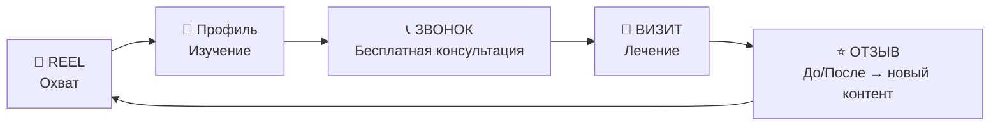

================================================================================
           T R I U M P H   G R O U P   |   l a b s
           СТРАТЕГИЯ v3.0 — ПОД РЕАЛЬНЫЙ БИЗНЕС
================================================================================

# ПРОФИЛЬ КЛИЕНТА

| Параметр | Данные |
|----------|--------|
| **Формат** | ИП, стоматологический кабинет (аренда комнаты в клинике) |
| **Врач** | Отец — стоматолог, основной (и единственный) специалист |
| **Услуги** | Импланты · Кариес · Пломбы · Чистка · Керамика (виниры/коронки) |
| **НЕ делают** | Детская стоматология |
| **График** | ПН, СР, ЧТ, ПТ, СБ · Смена 1: 10:00–16:00 · Смена 2: 16:00–22:00 |
| **Поток** | ~5 клиентов в неделю (текущий) |
| **Монетизация** | Процент с клиентов |
| **Конверсия** | Акцент на **звонки по телефону** + бесплатная консультация |
| **Контент-активы** | Есть фото/видео «До / После» |
| **Амбиция** | Выход в другие страны (медицинский туризм) |
| **Локация** | Армения, всё организуют внутри страны |

---

> [!IMPORTANT]
> **Ключевой вывод из вводных:** Это не крупная премиум-клиника — это **растущий семейный бизнес с амбициями**. Стратегия должна быть: 1) бюджетной в продакшене, 2) максимально конверсионной (каждый ролик = звонки), 3) масштабируемой (фундамент для выхода в другие страны).

---

# 1. СТРАТЕГИЧЕСКАЯ РАМКА

## Главная цель месяца

```
5 клиентов/нед → 10–12 клиентов/нед (×2 за 30 дней)
```

## Как Reels приводят клиентов (воронка)



**Каждый Reel заканчивается одним CTA:**
> 📞 **Позвоните — бесплатная консультация: +374 XX XXX XX XX**

Не DM. Не «ссылка в шапке». **Телефон.** Потому что звонок = самый тёплый лид.

---

# 2. ВИЗУАЛЬНЫЙ СТИЛЬ (БЮДЖЕТНЫЙ, НО ДОРОГОЙ)

> [!TIP]
> Нет бюджета на студию и 3D? Не проблема. «Дорогой» визуал = правильный свет + чистый фон + уверенная подача. iPhone + кольцевая лампа + чёрный/белый фон = 80% от студийного результата.

### Минимальный продакшен-кит

| Что | Зачем | Стоимость |
|-----|-------|-----------|
| Кольцевая лампа 18" | Ровный профессиональный свет | ~$30–50 |
| Чёрная ткань (2×2м) | Фон для макро и «до/после» | ~$10 |
| Штатив для телефона | Стабильная картинка | ~$15 |
| CapCut (бесплатно) | Монтаж, субтитры, эффекты | $0 |
| Canva Pro | Карусели, обложки | ~$13/мес |

### Цветовая палитра

```
Фоны:          #0D0D0D (чёрный)    — для съёмки «до/после», макро
Акцент:        #C9A96E (золото)     — номер телефона, CTA
Текст:         #FFFFFF (белый)      — субтитры, заголовки
Доверие:       #4A90D9 (синий)      — иконки, галочки фактов
Тепло:         #E8D5C4 (нюд)       — кадры с пациентами
```

### Правило «3 кадра»
Каждый ролик строится из **максимум 3 типов кадров**:
1. **Лицо врача** (доверие, экспертность)
2. **Руки за работой / оборудование** (профессионализм)
3. **Результат: улыбка пациента** (эмоция, конверсия)

---

# 3. АУДИТОРИЯ

### Кому продаём

| Сегмент | Боль | Триггер звонка | Язык |
|---------|------|---------------|------|
| **Ереван, жен. 25–45** | Кариес запустила, стыдно улыбаться | «До/после» + бесплатная консультация | 🇦🇲 Армянский |
| **Ереван, муж. 30–55** | Зуб болит, тянул до последнего | «Без боли, за 1 визит» | 🇦🇲 Армянский |
| **Армения (регионы)** | Нет хорошего стоматолога в городе | Экспертность + доступная цена | 🇦🇲 Армянский |
| **Медтуристы РФ** (перспектива) | Дорого в Москве | Цена ×2 ниже + качество | 🇷🇺 Русский |

### Языковая стратегия (месяц 1)

```
80% контента — армянский (основной поток клиентов)
20% контента — русский (тест спроса на медтуризм)
Все ролики — с субтитрами на обоих языках
```

---

# 4. КОНТЕНТ-ПЛАН: 12 REELS (3 в неделю)

> [!IMPORTANT]
> **Принцип:** Никаких абстрактных «имиджевых» роликов. Каждый Reel решает конкретную задачу: снять страх, показать результат, или назвать причину позвонить.

---

## НЕДЕЛЯ 1: «Я ЗНАЮ СВОЁ ДЕЛО» — Экспертность + Первое впечатление

---

### REEL 1 · «Познакомьтесь с вашим врачом»
**Хронометраж:** 20–25 сек

| Параметр | Описание |
|----------|---------|
| **Цель** | Персонализация. Люди идут к человеку, не в клинику |
| **Крючок (0–2 сек)** | Врач (отец) смотрит в камеру: «Я лечу зубы 20+ лет. Вот что я понял за это время.» |
| **Тело** | 3 коротких тезиса, каждый — смена кадра: 1) «Нет плохих зубов — есть запущенные» (кадр: руки за работой) 2) «Боль — это миф прошлого» (кадр: оборудование) 3) «Каждый заслуживает улыбку» (кадр: довольный пациент) |
| **CTA** | Экран: 📞 +374 XX XXX XX XX · Бесплатная консультация |
| **Съёмка** | iPhone + кольцевая лампа. Врач в халате, чистый фон |
| **Монтаж** | CapCut: субтитры, плавные переходы, фоновый ambient |
| **Stories** | В тот же день: «Задайте доктору вопрос» (стикер Q&A) |

---

### REEL 2 · «До / После: Кариес, который тянули 3 года»
**Хронометраж:** 15–20 сек

| Параметр | Описание |
|----------|---------|
| **Цель** | Показать результат + снять страх «у меня всё запущено» |
| **Крючок (0–1.5 сек)** | Чёрный экран → макро фото «ДО» (с разрешения пациента). Текст: «Пациент тянул 3 года.» |
| **Тело** | Плавный переход → фото «ПОСЛЕ». Голос врача: «За 2 визита. Без боли. Вот результат.» |
| **CTA** | 📞 Позвоните — покажем, что можно сделать с ВАШИМ случаем. Бесплатно. |
| **Съёмка** | Фото до/после (уже есть) + закадровый голос |
| **Монтаж** | CapCut: слайд-анимация, zoom, субтитры |
| **Stories** | Carousel: 3 кейса «До/После» в тот же день (saves-контент) |

> **Важно:** «До/После» — это **самый конверсионный формат** в стоматологическом Instagram. У вас уже есть эти материалы — используем их как главное оружие.

---

### REEL 3 · «Чистка зубов: Зачем платить, если можно чистить дома?»
**Хронометраж:** 25–30 сек

| Параметр | Описание |
|----------|---------|
| **Цель** | Продажа самой доступной услуги (низкий порог входа → знакомство с клиникой) |
| **Крючок** | «Зубная щётка убирает 60% налёта. Остальные 40% — вот здесь.» (показывает на макро-фото зубного камня) |
| **Тело** | Врач объясняет: камень → воспаление → потеря зуба. Быстро, просто, без запугивания |
| **Кадры** | Лицо врача → макро зубного камня → процесс чистки → чистые зубы |
| **CTA** | 📞 Профессиональная чистка — от [цена]. Позвоните, запишитесь: +374 XX XXX XX XX |
| **Stories** | Опрос: «Когда вы последний раз делали профчистку?» (poll: < 6 мес / > 1 года / никогда) |

> **Зачем чистка в контент-плане?** Это **воронка входа**. Человек приходит на чистку за $30–50, знакомится с врачом, узнаёт о кариесе — и остаётся на лечение. Самый дешёвый способ привлечь клиента.

---

## НЕДЕЛЯ 2: «БЕЗ БОЛИ, БЕЗ СТРАХА» — Снятие возражений

---

### REEL 4 · «Топ-3 страха перед стоматологом (и почему они устарели)»
**Хронометраж:** 30 сек

| Параметр | Описание |
|----------|---------|
| **Цель** | Снять главный барьер — страх боли |
| **Крючок** | Врач: «Знаете, чего боятся мои пациенты больше всего? Не боли.» (пауза) «Они боятся, что будет стыдно показать зубы.» |
| **Тело** | 3 страха → 3 ответа: 1) «Будет больно» → «Современная анестезия — вы не почувствуете укол» 2) «Осудят за запущенность» → «Я видел всё. Моя работа — помочь, не судить» 3) «Это дорого» → «Бесплатная консультация. Точная цена — ДО начала лечения» |
| **CTA** | 📞 Первый шаг — просто позвонить. Консультация бесплатно: +374 XX XXX XX XX |
| **Stories** | «Какой ваш главный страх перед стоматологом?» (quiz-стикер) |

> **Почему этот ролик важен:** 70% людей откладывают визит к стоматологу из-за страха. Этот ролик говорит: «Я вас понимаю. Я не осужу. Просто позвоните.» Это конвертирует тех, кто «давно собирался».

---

### REEL 5 · «До / После: Керамические коронки — как настоящие»
**Хронометраж:** 15–20 сек

| Параметр | Описание |
|----------|---------|
| **Цель** | Продажа керамики (высокий чек) через визуальный результат |
| **Крючок** | Макро: два зуба рядом. «Один из них — керамика. Угадаете какой?» |
| **Тело** | Пауза 2 сек → ответ. Затем: «Керамические коронки — прочность металла, красота настоящего зуба. Служат 15+ лет.» |
| **CTA** | 📞 Узнайте, подходит ли вам керамика — бесплатная консультация: +374 XX XXX XX XX |
| **Stories** | Голосование: «Угадали?» + ещё 2 примера «Где керамика?» |

---

### REEL 6 · «Имплант за 30 секунд: Как это работает»
**Хронометраж:** 30 сек

| Параметр | Описание |
|----------|---------|
| **Цель** | Объяснить импланты просто → снять страх → конверсия |
| **Крючок** | «Имплант — это НЕ то, что вы думаете. Смотрите.» |
| **Тело** | Врач берёт модель челюсти (есть в каждом кабинете) и показывает: 1) «Титановый винт — вот он» (показывает) 2) «Вкручиваем сюда» (демонстрация на модели) 3) «Сверху — коронка. Готово. Как родной зуб.» |
| **Ключевой кадр** | Улыбка реального пациента с имплантом (до/после) |
| **CTA** | 📞 Импланты от [цена]. Консультация бесплатно: +374 XX XXX XX XX |
| **Stories** | Carousel: «5 мифов об имплантах» (saves-контент) |

> **Почему импланты = приоритет:** Самый высокий чек. Один клиент на импланты = 5–10 клиентов на чистку по выручке. Каждый ролик об имплантах потенциально окупает весь месяц контента.

---

## НЕДЕЛЯ 3: «ДОВЕРИЕ ЧЕРЕЗ ЛЮДЕЙ» — Социальное доказательство

---

### REEL 7 · «Отзыв пациента: "Я не улыбался 5 лет"»
**Хронометраж:** 30–45 сек

| Параметр | Описание |
|----------|---------|
| **Цель** | Социальное доказательство → эмоциональная конверсия |
| **Крючок** | Пациент (реальный) в камеру: «Я не фотографировался с открытым ртом 5 лет.» |
| **Тело** | Короткая история: проблема → страх → звонок → лечение → результат. Финал: пациент широко улыбается |
| **Съёмка** | iPhone, естественный свет. НАМЕРЕННО «живая» съёмка — доверие > продакшен |
| **CTA** | 📞 Позвоните — первый шаг к вашей новой улыбке: +374 XX XXX XX XX |
| **Stories** | Репост: благодарственное сообщение от пациента (скриншот с разрешения) |

> **Как получить отзыв:** После каждого успешного лечения: «Вам понравился результат? Можете сказать пару слов на камеру? 30 секунд, это поможет другим людям решиться.» 8 из 10 согласятся.

---

### REEL 8 · «До / После: Полная реставрация улыбки»
**Хронометраж:** 20 сек

| Параметр | Описание |
|----------|---------|
| **Цель** | Самый мощный визуальный удар — полная трансформация |
| **Крючок** | Чёрный экран. Текст: «Она не улыбалась на фото 10 лет.» |
| **Тело** | Фото «ДО» (2 сек) → плавный переход → фото «ПОСЛЕ» (3 сек) → видео пациентки: она улыбается, смеётся |
| **Текст на экране** | Этапы: Импланты (×3) + Керамика (×8) = Новая улыбка |
| **CTA** | 📞 Хотите узнать план для ВАШЕЙ улыбки? Звоните: +374 XX XXX XX XX |
| **Stories** | «Листайте →» — серия из 5 «до/после» кейсов (saves) |

---

### REEL 9 · «Рабочий день стоматолога с 20-летним стажем»
**Хронометраж:** 30–40 сек

| Параметр | Описание |
|----------|---------|
| **Цель** | Показать человека за профессией → доверие и тепло |
| **Крючок** | Врач заходит в кабинет утром. «10:00. Начинаем.» |
| **Тело** | Нарезка дня: подготовка кабинета → приём пациента → работа (макро рук) → перерыв (чай, улыбка) → следующий пациент → конец дня: «Сегодня — 4 улыбки» |
| **Настроение** | Тёплое, человечное. Не «крутая клиника», а «надёжный доктор» |
| **CTA** | 📞 Запишитесь на удобное время: +374 XX XXX XX XX |
| **Stories** | BTS-кадры со съёмки этого ролика |

---

## НЕДЕЛЯ 4: «ПОРА ДЕЙСТВОВАТЬ» — Конверсия

---

### REEL 10 · «Сколько стоит лечение? Честные цифры»
**Хронометраж:** 25–30 сек

| Параметр | Описание |
|----------|---------|
| **Цель** | Снять ценовое возражение → самый частый вопрос = самый вирусный контент |
| **Крючок** | «Все спрашивают "сколько?". Отвечаю честно.» |
| **Тело** | Врач называет вилки цен: • Чистка — от XX,000 AMD • Пломба — от XX,000 AMD • Керамика — от XX,000 AMD • Имплант — от XX,000 AMD «Точная цена — после бесплатного осмотра. Без сюрпризов.» |
| **CTA** | 📞 Позвоните — узнайте точную стоимость для ВАШЕГО случая: +374 XX XXX XX XX |
| **Stories** | Carousel: «Из чего складывается цена импланта» (5 слайдов) |

> **Почему цены = вирус:** Ролики о ценах собирают в 3–5 раз больше сохранений и комментариев. Люди спорят, сравнивают, пересылают друзьям. Алгоритм это любит.

---

### REEL 11 · «До / После: Пломба, которую не отличить от зуба»
**Хронометраж:** 15 сек

| Параметр | Описание |
|----------|---------|
| **Цель** | Продажа «простой» услуги — но через WOW-результат |
| **Крючок** | Макро: зуб после пломбирования. «Найдите пломбу.» |
| **Тело** | Пауза 3 сек → обводка показывает пломбу. «Современные материалы = невидимая реставрация» |
| **CTA** | 📞 Есть кариес? Не тяните. Бесплатная консультация: +374 XX XXX XX XX |
| **Stories** | Ещё 3 примера «Найди пломбу» (интерактив → вовлечение) |

---

### REEL 12 · «Вашей улыбке нужен только один звонок»
**Хронометраж:** 20 сек

| Параметр | Описание |
|----------|---------|
| **Цель** | Максимальная конверсия — итог месяца |
| **Крючок** | Нарезка лучших «ДО/ПОСЛЕ» за месяц (3–4 кейса, по 2 сек каждый) |
| **Тело** | Врач в камеру: «Каждый из этих людей начал с одного звонка. Бесплатная консультация. Без обязательств. Просто узнайте, что можно сделать.» |
| **Финал** | Крупно на экране: 📞 **+374 XX XXX XX XX** БЕСПЛАТНАЯ КОНСУЛЬТАЦИЯ |
| **CTA** | Номер телефона на экране 5 секунд (чтобы успели записать/запомнить) |
| **Stories** | Серия из 5 Stories: «Самые популярные вопросы этого месяца» + countdown «Свободных окон осталось: X» |

---

# 5. ЭКОСИСТЕМА КОНТЕНТА

### Stories (ежедневно, 3–5 шт.)

| Тип | Когда | Пример |
|-----|-------|--------|
| **Утро: «Кабинет готов»** | 09:50 (до начала смены) | Фото/видео чистого кабинета: «Доброе утро! Ждём вас 😊» |
| **День: Интерактив** | 13:00 | Poll: «Как часто вы ходите к стоматологу?» / Quiz: «Правда или миф?» |
| **Рабочий момент** | В течение дня | BTS: стерилизация, подготовка, macro руки за работой |
| **Вечер: CTA** | 18:00 | «Завтра есть 2 свободных окна. 📞 Позвоните: +374 XX XXX XX XX» |

### Carousel-посты (2 в неделю)

| Тематика | Пример |
|----------|--------|
| **Образовательный** | «5 признаков, что кариес уже начался» |
| **До / После** | Подборка 3–4 кейсов (saves-контент) |
| **Чек-лист** | «Что взять на приём к стоматологу» |
| **Сравнение** | «Пломба vs Вкладка vs Коронка — когда что нужно» |

### Переупаковка контента

```
1 Reel → 3 Stories (фрагменты) 
       → 1 Carousel (расширенная версия)
       → 1 пост в Facebook (армянская аудитория активна там)
       
Итого: 12 Reels → 60+ единиц контента за месяц
```

---

# 6. РАСПИСАНИЕ ПУБЛИКАЦИЙ

### Календарь (привязан к рабочим дням клиники)

| День | Контент | Время публикации | Почему |
|------|---------|-----------------|--------|
| **ПН** | **Reel** | 12:00 | Обед = пик скролла. Начало недели = мотивация записаться |
| **СР** | **Reel** + Carousel | 12:00 / 19:00 | Середина недели = пик вовлечения |
| **ЧТ** | Carousel | 19:00 | Вечерний saves-контент |
| **ПТ** | **Reel** | 11:00 | Утро пятницы = планирование на выходные |
| **СБ** | Stories only | Flexible | Лёгкий контент: «Работаем и в субботу! 📞» |
| **ВТ, ВС** | Выходные | Stories (1–2 шт.) | Отложенный контент: мотивационные цитаты, напоминания |

---

# 7. ОФОРМЛЕНИЕ ПРОФИЛЯ INSTAGRAM

### Шапка профиля (Bio)

```
🦷 Стоматолог · 20+ лет опыта
📍 Ереван, Армения
✅ Импланты · Керамика · Лечение
📞 Бесплатная консультация:
👇 ПОЗВОНИТЕ ПРЯМО СЕЙЧАС
```

**Кнопка действия:** «Позвонить» → +374 XX XXX XX XX

### Highlights (закреплённые Stories)

| Highlight | Содержание |
|-----------|-----------|
| 📞 **ЗАПИСАТЬСЯ** | Как записаться, номер, часы работы, адрес |
| ✨ **ДО / ПОСЛЕ** | Лучшие кейсы трансформаций |
| 🦷 **УСЛУГИ** | Что делаем: импланты, керамика, чистка, лечение |
| 💬 **ОТЗЫВЫ** | Видео и скриншоты отзывов пациентов |
| ❓ **FAQ** | Ответы на частые вопросы (больно?, сколько?, как долго?) |

---

# 8. KPI — КАК ПОНЯТЬ, ЧТО РАБОТАЕТ

### Метрики первого месяца

| Метрика | Цель | Как считать |
|---------|------|------------|
| **Охват Reels (средний)** | 3 000–8 000 views | Instagram Insights |
| **Досмотры (>75%)** | > 35% для 20-сек роликов | Insights → Retention |
| **Сохранения** | > 30 на Reel | Insights → Saves |
| **Звонки с Instagram** | > 15 за месяц | Спрашивать: «Откуда узнали?» |
| **Записи на консультацию** | > 10 за месяц | Журнал записей |
| **Конверсия: запись → визит** | > 70% | Журнал |
| **Новые подписчики** | +300–800 за месяц | Insights |
| **Средний чек** | Отслеживать динамику | CRM / записи |

### Еженедельный мини-отчёт

```
📊 НЕДЕЛЯ X
──────────────
Reels: 3 шт. | Лучший: [название] — XX views
Звонки: X шт.
Записи: X шт.
Новые подписчики: +XX
──────────────
Что сработало: ...
Что меняем: ...
```

---

# 9. СТРАТЕГИЯ ВЫХОДА В ДРУГИЕ СТРАНЫ (ФУНДАМЕНТ)

> [!NOTE]
> Месяц 1 — локальный рынок. Но уже сейчас закладываем фундамент для медтуризма.

### Что делаем в месяц 1 для будущего масштабирования

| Действие | Зачем |
|----------|-------|
| Субтитры на русском в каждом Reel | Готовый контент для РФ-аудитории |
| 2 Reels на русском (тест) | Замер спроса из России |
| Хештеги на английском | Дискавери для диаспоры и иностранцев |
| Фиксируем цены в $ | Понятно для международной аудитории |
| Собираем базу «до/после» | Портфолио для международного лендинга |

### Масштабирование (месяцы 2–3)

```
Месяц 2: Если тест русского контента показал >500 views →
          Запуск отдельной серии «Стоматология в Армении: цены, качество, отдых»
          
Месяц 3: Лендинг на русском + контекстная реклама (Google Ads)
          «Виниры в Ереване — от $XXX. Включено: лечение + трансфер + отель»
```

---

# 10. БЮДЖЕТ ПРОДВИЖЕНИЯ

### Минимальный бюджет на платную рекламу

| Статья | Бюджет/мес | Что делаем |
|--------|-----------|------------|
| **Promote лучших Reels** | $50–100 | Промо 2–3 Reels с лучшим органическим результатом |
| **Таргет Ереван** | $50–100 | Женщины 25–45, интересы: здоровье, красота |
| **Тест РФ** (если запускаем) | $30–50 | Москва/СПб, «стоматология за рубежом» |
| **Итого** | **$130–250/мес** | |

> **ROI:** 1 клиент на импланты = средний чек $300–800. Если реклама за $150 приводит хотя бы 2 клиентов на импланты — окупаемость ×4–10.

---

# 11. РАСПРЕДЕЛЕНИЕ РАБОТЫ

### Кто что делает (команда из 2 человек)

| Задача | Triumph (ты) | Отец (врач) |
|--------|-------------|-------------|
| Сценарий/идея ролика | ✅ | Утверждение |
| Съёмка | ✅ Оператор | ✅ В кадре |
| Монтаж | ✅ | — |
| Публикация + подпись | ✅ | — |
| Stories ежедневные | ✅ (отложенные) + врач (BTS) | ✅ Рабочие моменты |
| Ответы на комментарии | ✅ | — |
| Звонки от клиентов | — | ✅ |
| «До / После» фото | — | ✅ После каждого кейса |
| Просьба об отзыве | — | ✅ После лечения |

### Недельный ритм

```
Воскресенье вечер:  Triumph → готовит 3 сценария Reels + контент-план Stories на неделю
Понедельник:        Съёмка Reel 1 (30 мин с врачом) → монтаж → публикация в 12:00
Среда:              Съёмка Reel 2 (30 мин) → монтаж → публикация в 12:00
Пятница:            Съёмка Reel 3 (30 мин) → монтаж → публикация в 11:00
Ежедневно:          Врач присылает 1–2 BTS-кадра → Triumph публикует в Stories
Суббота:            Анализ недели, планирование следующей
```

> **Время врача:** Максимум **30 минут × 3 = 1.5 часа в неделю** на съёмку. Остальное — работа Triumph.

---

# ИТОГО: ЧТО ОТЛИЧАЕТ ЭТУ СТРАТЕГИЮ

| Gemini v1 | Стратегия v3 |
|----------|-------------|
| Писал для «премиум-клиники» (которой нет) | Писал для **реального бизнеса**: ИП, 1 врач, 1 кабинет |
| Бюджет: Kling + After Effects + 3D-трекинг | Бюджет: **iPhone + CapCut + $150/мес на рекламу** |
| CTA: «Напишите в директ» | CTA: **📞 Позвоните — бесплатная консультация** |
| Аудитория: не определена | Аудитория: **4 сегмента с болями и триггерами** |
| Конверсия: Reel 12 | Конверсия: **каждый Reel = звонок** |
| Импланты: не упомянуты | Импланты: **приоритет #1 (самый высокий чек)** |
| Масштабирование: не планируется | Масштабирование: **фундамент для медтуризма с месяца 1** |
| Команда: 3 человека | Команда: **2 человека (ты + отец), врач = 1.5 ч/нед** |
| Время на врача: неопределённо | Время на врача: **30 мин × 3 раза = 1.5 часа в неделю** |

================================================================================
TRIUMPH GROUP [labs] © 2026. v3.0 — Built for reality. Built to convert.
================================================================================
